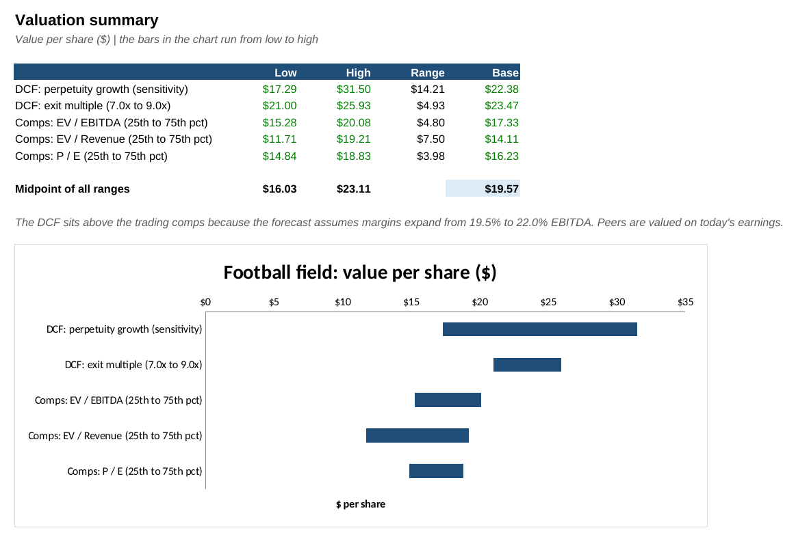
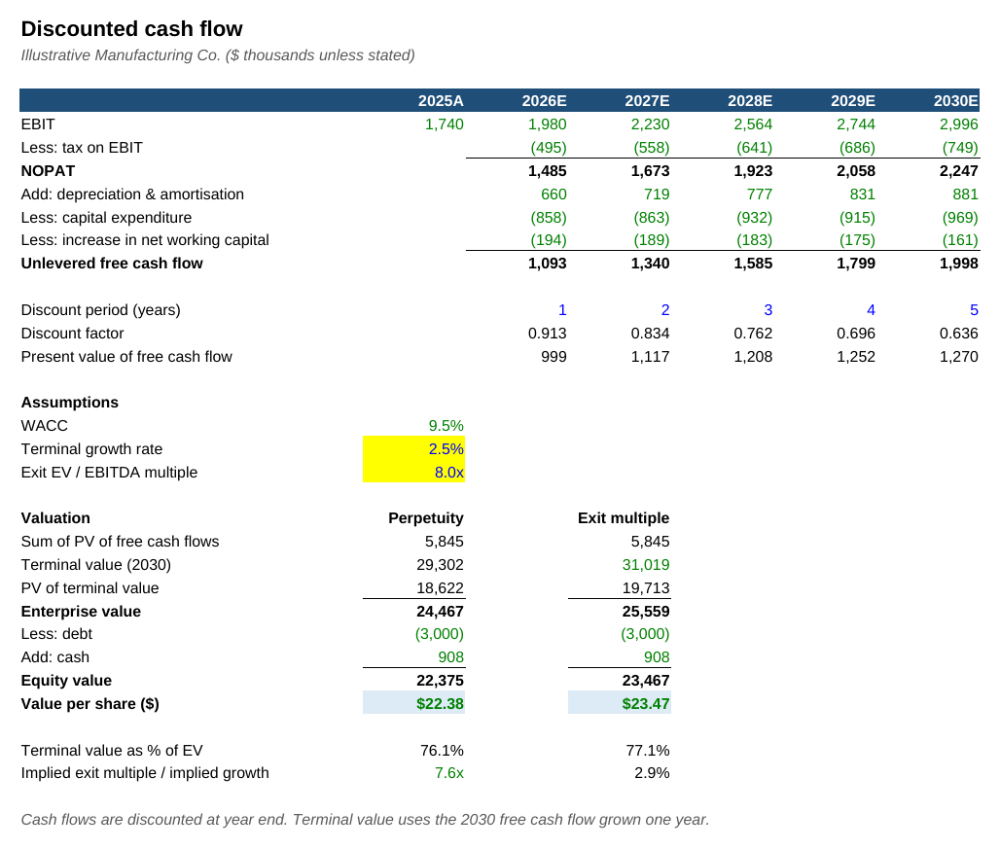
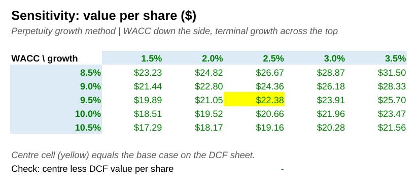
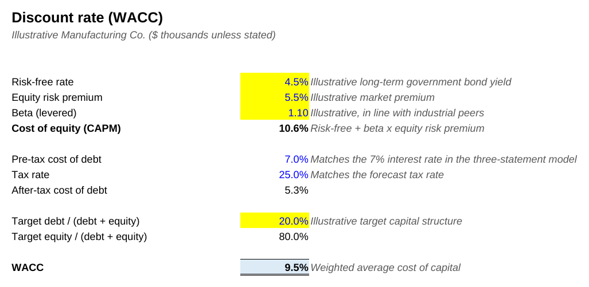
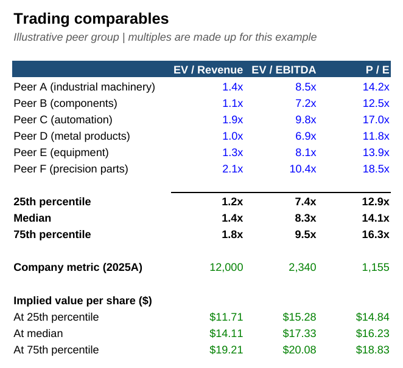

# DCF & Comparable Companies Valuation

A valuation of an illustrative manufacturing company using a discounted cash flow (two terminal value methods) and trading comparables, summarised in a football field chart. Built in Excel.

## What this does

The model works out what the company is worth per share, three different ways, and compares them on one page:

- **DCF, perpetuity growth:** $22.38 per share
- **DCF, exit multiple:** $23.47 per share
- **Trading comps (median EV / EBITDA):** $17.33 per share

The midpoint of all ranges is **$19.57 per share**. The DCF comes out higher than the comps because the forecast assumes EBITDA margin rises from 19.5% to 22.0%, while peers are valued on today's earnings.

This project builds on my [Three-Statement Financial Model](https://github.com/MuhammedAnshajK/three-statement-model): its base-case forecast is the input here.

## Data

The forecast comes from the base case of the three-statement model. Market inputs (risk-free rate, beta, equity risk premium) and peer multiples are illustrative, not real market data. Figures are in $ thousands unless stated.

## Approach

1. **Forecast.** I took revenue, EBITDA, D&A, capex and net working capital for 2025 to 2030 from the three-statement model.
2. **Free cash flow.** Unlevered free cash flow = EBIT x (1 - tax) + D&A - capex - increase in net working capital.
3. **Discount rate.** Cost of equity from CAPM (4.5% + 1.10 x 5.5% = 10.6%). After-tax cost of debt is 5.25%. Weighting them 80/20 gives a WACC of 9.5%.
4. **Terminal value, two ways.** Perpetuity growth at 2.5%, and an exit multiple of 8.0x 2030 EBITDA. Each method's implied version of the other (7.6x and 2.9%) is shown as a sense check.
5. **Enterprise to equity value.** Enterprise value less debt plus cash, divided by 1.0m shares.
6. **Sensitivity.** A 5 x 5 table shows value per share as WACC moves ±1% and terminal growth moves ±1%.
7. **Comparables.** Six peers' EV / Revenue, EV / EBITDA and P / E multiples. The 25th to 75th percentile range is applied to the company's 2025 figures.
8. **Football field.** All ranges are shown side by side so the methods can be compared at a glance.

## Screenshots

| DCF | Sensitivity |
|---|---|
|  |  |

| WACC | Comparables |
|---|---|
|  |  |

## How to use

1. Download `dcf_valuation.xlsx`.
2. Change any blue or yellow cell, such as beta on the **WACC** sheet, terminal growth or the exit multiple on the **DCF** sheet, or a peer multiple on **Comps**.
3. The **Summary** sheet and football field chart update automatically.

Colour key: blue = hardcoded input, black = formula, green = link to another sheet, yellow = key assumption.

## Files

- `dcf_valuation.xlsx`: the model (Cover, Forecast, WACC, DCF, Sensitivity, Comps, Summary)
- `build_model.py`: Python script (openpyxl) that generates the workbook
- `images/`: screenshots

## Tools

Excel, Python (openpyxl)
